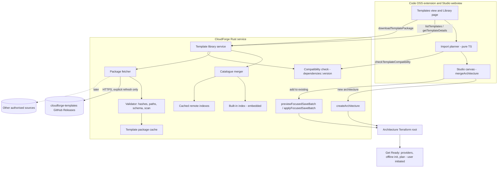
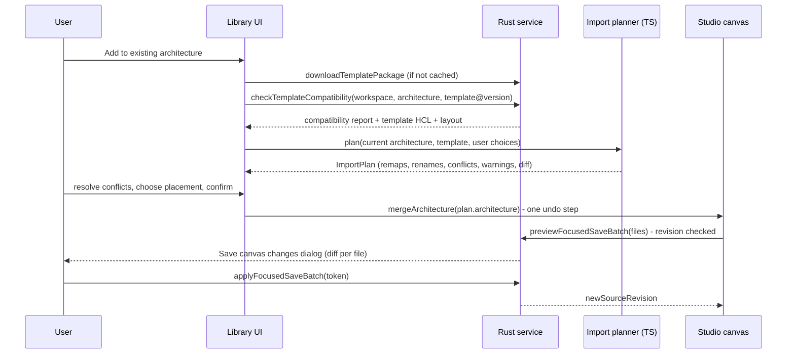
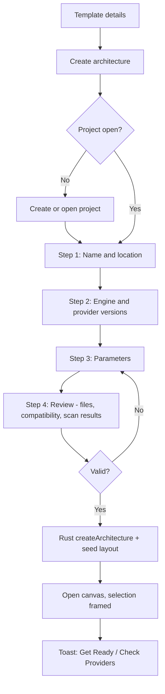
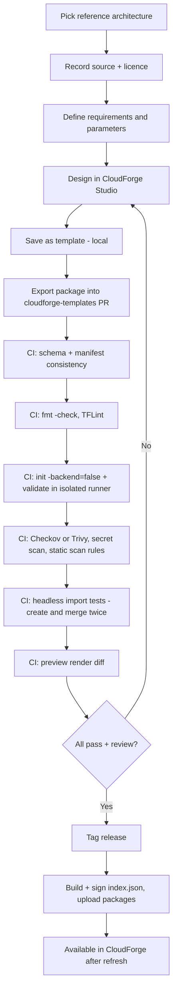

# CloudForge Template & Architecture Library — Specification

**Status:** Checkpoint 1 approved by Dale on 26 November 2026 (all Appendix B recommendations accepted). Phase 2 in progress from main.
**Date:** 26 November 2026 · **Author:** Claude, for Dale
**Repositories inspected:** `fXrazor/vscode` (Code OSS + CloudForge extension and Studio) and `fXrazor/CloudForge` (Rust service, `design.md`), both at branch `claude/project-thread-8qd376` (vscode `83d07623`, CloudForge `2c6f0bc`), which carries the unmerged bundle, Providers view, Add Architecture and Get Ready work on top of main.
**Spec branch:** `claude/project-thread-2dm0k0` in both repositories.

> **How to read this document.** Every statement is tagged where it matters:
> **[Verified]** = checked in the repository or on a fetched public page on 26 November 2026.
> **[Assumption]** = reasoned but not checked.
> **[Proposed]** = new CloudForge behaviour this spec recommends. Nothing marked Proposed exists yet.

## Contents

- [Executive summary](#executive-summary)
- [Discovery findings (what already exists)](#discovery-findings-what-already-exists)
- [1. Implementation Plan](#implementation-plan)
- [2. Architecture Strategy](#architecture-strategy)
- [3. UI/UX Design Specification](#uiux-design-specification)
- [4. Cloud Research & Template Library Structure](#cloud-research--template-library-structure)
- [Appendix A. Architectural decision records](#appendix-a-architectural-decision-records)
- [Appendix B. Open questions for Dale](#appendix-b-open-questions-for-dale)
- [Appendix C. Graphify evidence](#appendix-c-graphify-evidence)

## Executive summary

CloudForge already has the beginnings of a template library, but it is spread across **five unconnected places** with three different data shapes, and the most complete one cannot be reached from the current UI. The recommendation is to consolidate them into one **template package format that extends the existing `.cloudforge.zip` project bundle**, served through a **hybrid model**: a small signed built-in collection that ships with CloudForge and works offline, plus a separate, independently released **`cloudforge-templates`** repository whose catalogue index is downloaded separately from packages. Users can add further sources (federation) later without changing the format.

The key design decisions:

1. **Terraform is the authoritative representation** inside a template, exactly as it already is for projects. `architecture.json` is a layout and presentation overlay keyed by Terraform address, the same rule the bundle import already uses. This avoids a second source of truth.
2. **The Rust service owns** every network fetch, archive extraction, integrity check, compatibility check and file write, in line with `AGENTS.md` ("keep native authorization, credentials, filesystem access, and managed tool execution in Rust"). The extension and Studio only render and plan.
3. **Import into an existing architecture is a two-phase, previewed change** built on the existing `previewFocusedSaveBatch` / `applyFocusedSaveBatch` token flow plus Studio's single-step undo, so a failed or cancelled import leaves the project untouched.
4. **A template never changes a project's provider versions silently.** Compatibility is computed with the Rust service's existing constraint code (`service/src/dependencies/version.rs`) against the project's lock file and constraints, and conflicts are shown with explicit options.
5. **Importing never runs** `init`, `plan`, `apply`, scripts or providers. The existing Get Ready command stays the only way to download providers and run init/plan.

Estimated effort for Phases 2–5 is **about 22–33 focused build days**, plus Dale's review time at four checkpoints and the Windows test passes Dale runs during usage-limit downtime. Phase 1 (this document) is complete apart from approval.

## Discovery findings (what already exists)

### Repository and documentation sources read

| Source | Relevant content |
| --- | --- |
| `CloudForge/AGENTS.md` | Rust owns authorization, credentials, filesystem and tool execution; use `brainstorming`, `using-git-worktrees`, `verification-before-completion`; record Graphify revision in handoffs. [Verified] |
| `CloudForge/design.md` v1.0 (approved) | Section **Projects and Template Library** already specifies a Templates gallery: search, provider filter, sort, diagram thumbnails, preview with **Use Template**, offline bundled and locally saved templates, "use the same template twice in one project" with independent folders and state targets. The left rail lists **Projects, Templates, Search, Resources, Runs, Connections, Settings**. Brainboard's Templates gallery is the named layout reference. [Verified] |
| `CloudForge/design.md` › Provider dependencies | Engine CLI is the authority for install and locking; per-architecture Terraform roots; mirror for offline; "the user's HCL remains authoritative" in linked folders; exports exclude secrets, state, provider binaries. Baseline AzureRM `5.14.0` with `~> 5.14`. [Verified] |
| `CloudForge/HANDOFF.md` | Stage 10A `createArchitecture`, 10D–10F focused saves, 12A topology blueprints and MCP, provider download/registry slices on `claude/project-thread-8qd376`. [Verified] |
| `CloudForge/docs/protocol/cloudforge-service-v1.md` | Method contracts used below (`createArchitecture`, `previewFocusedSaveBatch`, `applyFocusedSaveBatch`, `listProviderVersions`, `getTopologyBlueprint`). [Verified] |
| `CloudForge/docs/graphify.md`, `tools/graphify.ps1` | Graphify 0.9.111 wrapper. Its source scope is `src/`, `src-tauri/`, `tools/`, `tests/`, and **does not include `service/`**, where most current Rust work lives. [Verified] |
| `vscode/HANDOFF.md` (repo root) and `extensions/cloudforge/studio/STUDIO-CONTINUATION-2026-11-25.md` | Running log; newest entries cover bundle export/import, Providers view, Add Architecture, Get Ready, startup screen. [Verified] Note: there is no `extensions/cloudforge/HANDOFF.md`; the handoff is at the repository root. |
| `vscode/docs/cloudforge/*.md` | Existing spec location (offline provider management spec, runner view design, repository map). This spec is saved here. [Verified] |

### Existing template-like code (the duplication problem)

| # | Location | Shape | Content | Reachable from UI? |
| --- | --- | --- | --- | --- |
| 1 | `extensions/cloudforge/src/canvas/templateLibrary.ts` `TEMPLATE_LIBRARY` | `ArchitectureTemplate` with `starterMainTf` string, `thumbnailNodes`, tags, `resourceCount` | 6 templates: Azure Hub Network, Azure Secure Spoke, Azure Edge Perimeter, AWS Two-Tier VPC, GCP Custom VPC, Kubernetes App Namespace. AzureRM `~> 5.14`. | **No.** Only the `useTemplateAsArchitecture` message handler in `canvasPanel.ts` calls it, and no webview sends that message (Graphify and grep both show no sender). |
| 2 | `extensions/cloudforge/src/canvas/patterns.ts` `STARTER_PATTERNS` + `instantiateStarterPattern` | Canvas nodes/edges + `ResourceDraft`s | 3 Azure patterns mirroring #1 | **No.** `instantiateStarterPattern` has zero callers in the Graphify graph. |
| 3 | `CloudForge/service/src/topologies.rs` `TOPOLOGY_BLUEPRINTS` | Rust static multi-file HCL with per-file rationale and skill IDs | 5 blueprints: `azure-hub-spoke`, `aws-vpc-3tier`, `gcp-regional-lb`, `azure-aks-vnet`, `aws-eks-vpc`. **AzureRM `~> 4.0`.** | Only through the MCP tool `cloudforge_get_topology_blueprint` and RPC `getTopologyBlueprint`. |
| 4 | `studio/src/App.tsx` `addTemplate` + `ResourceCatalogue` **Templates** tab | Slices of Studio's `sampleArchitecture()` fixture, inserted with the `insert` reducer action | 2 samples ("Private network", "Application platform") | **Yes.** This is what **Add Architecture › From a template** actually opens today, so the user sees 2 canvas samples rather than the 6 templates in #1. |
| 5 | `studio/src/workflowTemplate.ts` | Drawing-only Studio pattern | 1 workflow diagram | Yes, from the Shapes panel. |

**Implications.** (a) The first job is consolidation, not more templates. (b) The version mismatch between #1 (`~> 5.14`) and #3 (`~> 4.0`) is a live example of the compatibility problem §2.5 must solve. (c) Phase 3 must fix the dead end in **Add Architecture › From a template**.

### Reusable building blocks [Verified]

| Capability | Where | Reuse in the library |
| --- | --- | --- |
| Portable bundle format `cloudforge.project-bundle` v1: manifest with per-file SHA-256, `architecture.json`, `terraform/`, SVG diagram, README, secrets omitted | `studio/src/projectBundle.ts` (`buildProjectBundle`, `readProjectBundle`), `src/project/projectBundle.ts` | Base of the template package format (§2.4). |
| Create a new architecture from files (validated names, ≤16 `.tf`/`.tf.json`/`.tfvars` starters, 2 MiB each, 8 MiB total, staged publish, never replaces) | Rust `createArchitecture` (`service/src/workspace/project.rs`) | "Create new project/architecture from template". |
| Layout restore by Terraform address after create | `ProjectController.createArchitectureFromBundle` → `seedBundleLayout` | Template canvas positions. |
| Two-phase multi-file write with revision check and single token, atomic per file | Rust `previewFocusedSaveBatch` / `applyFocusedSaveBatch` | Transactional "add to existing architecture". |
| Canvas merge as one undo step, refusing id collisions; variable de-dupe by name | Studio reducer `mergeArchitecture` (`studio/src/model.ts`) | Canvas side of import; extended with remapping. |
| Endpoint remapping | `remapEndpoint` (`studio/src/connectionEndpoints.ts`) | Remapping imported connector ids. |
| Provider constraint parsing and intersection | `service/src/dependencies/{version,requirements,report}.rs` | Template compatibility check. |
| Registry fetch with cache, 24 h freshness, last-known-good fallback, `native-tls`, 20 s timeout, 4 MiB cap | `service/src/registry_service.rs` + `src-tauri/src/registry.rs` `RegistryCache` | Catalogue index fetch pattern. |
| Verified staging and atomic publish into a user store, path-traversal checks, leases | `src-tauri/src/mirror/store.rs` (`stage_and_publish_file`) | Template package cache. |
| Secret scanning (`SENSITIVE_LITERAL`) | `service/src/workspace/findings.rs`, `src/project/secretFindings.ts` | Save-as-template sanitising and package validation. |
| Projects gallery webview (cards, search, sort) | `src/project/gallery*.ts` | Visual pattern and code for the library grid. |
| Providers view modelled on Extensions (sidebar list + detail) | `src/providers/providersView.ts` | Navigation pattern for Templates. |
| Get Ready (download providers, offline init, plan) | `cloudforge.getReady` | The only post-import execution path. |

## Implementation Plan

### Timeline assumptions

Estimates are in **focused build days** for one agent working in this codebase, based on the observed pace of recent slices on `claude/project-thread-8qd376` (each of bundle export, Providers view, registry browse, Add Architecture and Get Ready took one working session of roughly half a day to a day including Rust + extension + checklist). They assume: no new frameworks; the Rust service keeps protocol 1 with additive methods; Windows `cargo test` and installed-build checks are run by Dale in batches (not counted here); template authoring time scales with the number of templates. Calendar time depends on Dale's review turnaround at each checkpoint.

| Phase | Build days | Main driver of the estimate |
| --- | ---: | --- |
| 1. Discovery and planning | done | This document. |
| 2. Package format, catalogue and Rust service | 6–9 | 6–8 new RPCs, schema files, verifier, cache; mostly mirrors existing mirror/registry code. |
| 3. Library UI and import/merge engine | 9–13 | Merge planner and conflict UI are the hardest new code; library views reuse gallery patterns. |
| 4. Initial catalogue (≈20 templates) + validation CI | 5–8 | ≈0.25 day per simple template, ≈0.5–1 day per advanced; CI pipeline 1–2 days. |
| 5. Testing, performance and release | 2–3 | Plus Dale's Windows passes. |
| **Total** | **22–33** | |

### Phase 1 — Discovery, research and architectural planning (complete, awaiting approval)

- **Objectives:** understand the codebase, research comparable ecosystems and licences, decide strategy and data model.
- **Tasks done:** repository and spec review (both repos), Graphify run on both repos ([Appendix C](#appendix-c-graphify-evidence)), research of Brainboard, Terraform/OpenTofu registries, Artifact Hub, Backstage, Helm, Azure Verified Modules, Quickstart Templates, Google Cloud modules, AWS Solutions ([§4.1](#41-research-findings-and-sources)), ADRs ([Appendix A](#appendix-a-architectural-decision-records)), data model ([§2.4](#24-template-package-specification), [§4.7](#47-template-metadata-schema)).
- **Deliverables:** this specification; Graphify reports in project files `template-library/graphify/`.
- **Acceptance criteria:** Dale approves the ADRs and answers the blocking questions in [Appendix B](#appendix-b-open-questions-for-dale).
- **Risks:** decisions made without user research. Mitigation: Phase 3 starts with a clickable HTML mock-up review before code.
- **Approval checkpoint 1 — strategy and requirements.** Approve: hybrid + external `cloudforge-templates` repo (ADR-001), HCL authoritative (ADR-002), Rust owns fetch/extract/write (ADR-003), consolidation of the five existing sources (ADR-004), navigation label and placement (ADR-008).

### Phase 2 — Template infrastructure and repository integration (6–9 days)

- **Objectives:** one package format, one catalogue, one Rust-owned library service with offline cache; existing templates migrated.
- **Dependencies:** Checkpoint 1. Merge (or rebase onto) `claude/project-thread-8qd376` first, because the bundle reader and `createArchitecture` `.tfvars` support live there.
- **Tasks:**
  1. JSON Schemas `template-manifest.schema.json`, `template-layout.schema.json`, `template-parameters.schema.json`, `catalogue-index.schema.json` (Draft 2020-12), checked into the CloudForge repo under `docs/protocol/schemas/templates/` with fixtures.
  2. Rust module `service/src/templates/` with: `manifest.rs` (parse/validate, `deny_unknown_fields` at top level, versioned), `package.rs` (bounded zip read, path rules, SHA-256 per file, size limits), `catalogue.rs` (index merge across sources), `store.rs` (cache using the mirror store's stage-and-publish pattern), `compat.rs` (constraint check via `dependencies::version`), `scan.rs` (static content scan, §2.8).
  3. RPCs (additive, protocol 1): `listTemplateSources`, `refreshTemplateCatalogue`, `listTemplates` (filter/search/sort server-side over the cached index), `getTemplateDetails`, `downloadTemplatePackage`, `importTemplatePackageFile` (broker-picked local file), `checkTemplateCompatibility`, `removeCachedTemplate`. Protocol doc rows and fixtures.
  4. Built-in collection: migrate the 6 + 3 + 5 + 2 existing items into packages (de-duplicating: e.g. one Azure hub-spoke), generate the built-in index at build time, embed it in the service binary (as `topologies.rs` does today) so it needs no file I/O to browse.
  5. Keep `getTopologyBlueprint` and the MCP tool working by reading from the new built-in collection (backward compatibility).
  6. Extension adapters (`serviceAdapters.ts` style) with strict response validation.
- **Deliverables:** schemas, Rust module + tests, protocol rows + fixtures, migrated built-in packages, test checklist.
- **Acceptance criteria:** `listTemplates` returns the built-in collection with the network disabled; a tampered package (changed byte, extra file, `../` path, symlink entry, oversize) is rejected with a specific fault; compatibility of the AzureRM `~> 4.0` blueprint against a `5.14.0` lock is reported as a conflict; MCP blueprint tool output unchanged in substance.
- **Testing:** Rust unit tests for parser, path rules, hashes, constraint intersection; fixture replay; `cargo clippy -D warnings`; Windows `cargo test` by Dale.
- **Risks:** signature scheme needs a new crate (see ADR-006) → keep SHA-256-in-signed-index as the minimum and gate signing on approval; built-in binary size growth → keep previews as small WebP/SVG and cap built-in size (≈2 MiB target).
- **Approval checkpoint 2 — repository strategy, schemas and contracts.** Approve schemas, RPC contracts, signing approach, and the creation of the `cloudforge-templates` repository.

### Phase 3 — Template Library UI/UX and application integration (9–13 days)

- **Objectives:** a Templates view in the activity bar, a library editor page, details page, create-from-template wizard, add-to-existing import with preview and conflict resolution, My Library.
- **Dependencies:** Checkpoint 2; Phase 3 starts with a static HTML mock-up (no product code) reviewed by Dale.
- **Tasks:**
  1. Mock-up review (≈0.5 day) of the five wireframes in §3.
  2. Activity-bar container **Templates** with a native tree (Featured, Downloaded, My Library, Sources), modelled on the Providers view.
  3. Editor-area webview **Template Library** (grid/list, filters, search), reusing `galleryHtml.ts` styling and VS Code theme tokens.
  4. Details page (tabs per §3.4) with a read-only canvas preview: Studio in a read-only mode fed by the template's `architecture.json`, so the preview uses the same renderer and icons.
  5. Create flow: wizard → `checkTemplateCompatibility` → parameter form → Rust `createArchitecture` with rendered files → `seedBundleLayout`.
  6. Import planner (pure TypeScript in `studio/src/templateImport.ts`): id remapping, Terraform name de-duplication, variable mapping, CIDR overlap detection, resource group / network reuse rewiring, placement offset. Output an `ImportPlan` the UI renders.
  7. Apply import: Studio `mergeArchitecture` (extended to accept a remap) as one undo step, then the existing **Save canvas changes** batch dialog (`previewFocusedSaveBatch` → `applyFocusedSaveBatch`).
  8. Canvas toolbar **Insert Template** and Studio's Templates tab replaced by the real library (search + insert).
  9. Fix **Add Architecture › From a template** to open the library in "create" mode.
  10. My Library: save project or selection as template (sanitiser + parameter picker), duplicate, version, export `.cftemplate.zip`, import local package, custom tags.
- **Deliverables:** views, wizard, import planner + tests, My Library, updated test checklist, screenshots.
- **Acceptance criteria:** see §3.8 and the end-to-end scenarios in Phase 5; importing the same template twice yields distinct ids, names and non-overlapping CIDRs or an explicit warning; cancelling at any step leaves files and canvas unchanged.
- **Testing:** planner unit tests (Node test runner as used by Studio); webview message validation tests; browser test view (as `scripts/build-test-view.mjs`) for the library; Dale's installed-build pass.
- **Risks:** merge edge cases (cross-file references, modules) → planner refuses unsupported cases with a clear message rather than guessing; UI scope creep → checkpoint before going beyond agreed screens.
- **Approval checkpoint 3 — UI designs, navigation and workflows.** Review the mock-up before implementation, and again after the first working build before extending scope.

### Phase 4 — Cloud provider library population (5–8 days)

- **Objectives:** ≈20 validated templates across Azure, AWS, GCP and one multi-cloud; authoring standards; validation CI in `cloudforge-templates`.
- **Dependencies:** Checkpoint 2 (format) and repo creation approved; Checkpoint 3 not required for authoring.
- **Tasks:** authoring guide (§4.8); per-template licence review record; author Wave 1 (§4.3–4.5); educational metadata for the certification-tagged subset (§4.6); CI pipeline (§4.8); preview generation script using Studio's existing SVG export.
- **Deliverables:** templates, CI, `CONTRIBUTING.md`, catalogue release `v0.1.0`.
- **Acceptance criteria:** every template passes schema, `fmt -check`, `validate` (in isolated CI), TFLint, Checkov or Trivy with documented suppressions, secret scan, and the automated import test; every template states its source and licence; no deployment to real cloud without explicit approval.
- **Risks:** provider schema drift → pin per template and re-validate on provider releases; licence ambiguity → only author original HCL, cite reference architectures as links (§4.1).

### Phase 5 — Testing, optimisation and release (2–3 days)

- **Objectives:** confidence on Windows, performance with large catalogues, offline behaviour, security review, documentation and Graphify mapping updates.
- **Tasks:** E2E scenarios (below); synthetic 5,000-entry catalogue for search/scroll performance; offline tests (no network, stale index, corrupt cache); security review of extractor and scanner; update `design.md` (with approval), handoffs, Graphify (including adding `service/` to the wrapper scope, see Appendix C).
- **E2E scenarios:** (1) offline first launch browses built-ins; (2) create architecture from template twice in one project; (3) insert hub-spoke into a project that already has `10.0.0.0/16` → overlap resolved by re-addressing; (4) AzureRM 5.x template into AzureRM 4.x project → conflict options; (5) save selection as template → export → import on clean profile; (6) catalogue update does not change existing projects; (7) tampered package rejected.
- **Acceptance criteria:** all scenarios pass on an installed Windows build; library opens < 300 ms from cache with 5,000 entries [Proposed target]; zero network calls when the user is offline or has disabled refresh.
- **Approval checkpoint 4 — release.** Dale approves merge to main and the installer build.

### Risk register (cross-phase)

| Risk | Likelihood | Impact | Mitigation |
| --- | --- | --- | --- |
| Two sources of truth (template HCL vs layout) drift | Medium | High | ADR-002: HCL authoritative; layout keyed by address; validator fails packages whose layout references unknown addresses. |
| Supply-chain attack via community source | Low now, rises with federation | High | Untrusted by default, static scan, no execution on import, signed official index, explicit trust prompt per source. |
| Licence violation from copying reference code/diagrams | Medium | High | Original HCL only; links not copies; per-template licence record; CI check that `LICENSE` and `source` exist. |
| Provider version conflicts frustrate users | High | Medium | Clear options (§2.5) and per-template tested provider ranges. |
| Merge engine complexity | Medium | Medium | Planner is pure and tested; unsupported shapes refused; transactional apply. |
| Built-in size bloat | Low | Low | Size budget and lazy previews. |
| Parallel agents editing `App.tsx` | Medium | Medium | Coordinate via handoff; keep new UI in new files. |

## Architecture Strategy

### 2.1 Separate template repository strategy

Scores: ● strong, ◐ mixed, ○ weak, for CloudForge's situation (desktop app, offline-first, single maintainer, possible future community).

| Criterion | Embedded | External repo | Hybrid | Registry service | Federated |
| --- | --- | --- | --- | --- | --- |
| Application size | ○ grows with every template | ● | ● small seed | ● | ● |
| Maintainability | ◐ simple, but app release per template | ● separate CI | ● | ◐ service to run | ◐ |
| Startup performance | ● | ● (lazy) | ● (index embedded) | ● | ◐ more sources |
| Discovery performance | ● | ◐ needs index | ● cached index | ● | ◐ |
| Offline availability | ● | ○ until cached | ● seed + cache | ○ | ◐ |
| Scalability | ○ | ● | ● | ● | ● |
| Security | ● reviewed with app | ◐ needs integrity | ● | ◐ | ○ unless trust model |
| Repository maintenance | ● one repo | ◐ two repos | ◐ two repos | ○ service ops | ○ |
| Community contributions | ○ PRs to app repo | ● | ● | ● | ● |
| Version management | ○ tied to app | ● per template | ● | ● | ● |
| Provider compatibility | ◐ | ● CI per template | ● | ● | ◐ varies |
| Distribution cost | ● none | ● GitHub free tier [Assumption] | ● | ○ hosting | ● |
| Release independence | ○ | ● | ● | ● | ● |
| Long-term extensibility | ○ | ◐ | ● | ● | ● |

**Recommendation [Proposed, ADR-001]:** **Hybrid now, federated-ready format, no hosted registry service.**

- **Built-in seed** (≈8–12 small templates, the consolidated existing ones) embedded in the Rust service, always offline.
- **`cloudforge-templates`** GitHub repository (official source) releasing a signed `index.json` and per-template package assets through **GitHub Releases**. No server to run. Static files are enough for the catalogue sizes expected (hundreds, not millions).
- **Sources list** in user settings so additional repositories (a team's private repo, a local folder) can be added later; each has a trust level. The official source is pre-configured; others are off until added.
- A hosted registry service is deferred until community publishing is approved; the static index format is designed so a service can serve the same JSON later.

**Do not create `cloudforge-templates` until Checkpoint 2.**

### 2.2 Proposed repository structure (`cloudforge-templates`)

```text
cloudforge-templates/
├── catalogue/                     # generated in CI, never hand-edited
│   └── (release asset) index.json, index.json.sig
├── taxonomy/
│   ├── providers.json             # azure, aws, gcp, multi-cloud, kubernetes
│   ├── categories.json
│   ├── certifications.json        # AZ-104 … with official study-guide links
│   └── tags.json                  # optional curated tags; free tags allowed
├── schemas/                       # copies of the versioned schemas from CloudForge (CI checks they match)
├── templates/
│   ├── azure/<template-id>/       # one folder per template, flat by provider
│   ├── aws/<template-id>/
│   ├── gcp/<template-id>/
│   └── multi-cloud/<template-id>/
├── collections/                   # curated lists (e.g. az-104-labs.json) referencing template ids
├── tools/                         # build-index, package, preview, validate scripts
├── tests/                         # import fixtures, golden previews
├── .github/workflows/             # validate on PR, release on tag
├── CONTRIBUTING.md  LICENSE  README.md  SECURITY.md
```

Refinements versus the illustrative structure: categories live in metadata, not folders (a template can be in several categories, §4.2); `patterns/` and `examples/` become `templateType` values instead of folders; `registry/` becomes a **generated** `catalogue/` so the index can never disagree with the packages; `collections/` adds curated certification and learning paths without duplicating templates.

### 2.3 Template distribution architecture

**Ecosystem concepts reviewed and what CloudForge adopts:**

| Ecosystem | Verified mechanism | Adopt? |
| --- | --- | --- |
| Terraform module registry protocol | Service discovery `modules.v1`; `GET …/:namespace/:name/:system/versions`; `GET …/:version/download` returns 204 with `X-Terraform-Get`; semver 2.0 expected. [Verified] | **Adopt** the split of "list versions" metadata from "download location", and semver. Templates may *reference* registry modules but CloudForge does not host modules. |
| OpenTofu Registry | Browsable UI at search.opentofu.org for modules and providers; docs at 1.13.x. [Verified] Module protocol details not confirmed on the pages read. | Same as Terraform; nothing extra. |
| GitHub Releases | Immutable tagged assets, free for public repos. [Assumption on cost] | **Adopt** as the official package host. |
| VS Code Marketplace | Gallery metadata separate from VSIX download; verified publisher. [Assumption, not re-fetched] | **Adopt** metadata/package split and publisher verification concept. |
| Helm | Chart `.tgz` with adjacent `.prov` file containing Chart.yaml + SHA-256 of the package, OpenPGP-signed; `helm verify`. [Verified] | **Adopt** "signed digest manifest next to the package"; use a simpler signature than OpenPGP (ADR-006). |
| Artifact Hub | `artifacthub-repo.yml` metadata; **Verified publisher** = owns/controls the repo; **Official** = publisher owns the software the package is about. [Verified] | **Adopt** the two-level trust vocabulary (§2.8). |
| Backstage Software Templates | `template.yaml` with `parameters` as JSON Schema rendered by react-jsonschema-form, `steps`, `output`; dry-run in the Template Editor. [Verified] | **Adopt** JSON Schema parameters and the dry-run idea (our import preview). Do **not** adopt arbitrary `steps`/actions: they execute code. |
| Azure Verified Modules | MIT licence mandatory (SNFR10); pattern modules compose resource modules; only latest version supported (SNFR12). [Verified] | **Reference** AVM modules from templates where appropriate; adopt "pattern vs resource" as `templateType`. |
| Brainboard | Templates = design + Terraform; Organization vs Public (Brainboard-published, verified); publish by right-click "Publish as template"; clone into new architecture or copy into current; status reviewing/approved; filters Scope, Providers, Tags; sort by name, provider, last updated; **no versioning described**. [Verified] | **Adopt** the two entry points (new vs into current), scope filter, review status. **Improve** with semantic versioning and compatibility, which Brainboard's docs do not describe. |
| OCI artifact registries | Generic artifacts in container registries (ORAS). [Assumption, not fetched] | **Defer.** Useful for enterprises later; the federated source interface can add an OCI source type. |

**Logical architecture [Proposed]:**



**Metadata/package split.** The index carries everything a card and details page need (name, summary, providers, categories, resource count, provider constraints, preview URL, package digest and size). Browsing downloads only the index (≈1–2 KB per template [Assumption]) and previews on demand. The package is fetched only on **Download**, **Create** or **Add**.

### 2.4 Template package specification

**Format [Proposed]:** a zip with extension `.cftemplate.zip`, which is the `.cloudforge.zip` bundle format with `format: "cloudforge.template"` and a richer manifest. One reader in Rust handles both; a project bundle can be converted to a template by adding parameters and metadata.

```text
azure-hub-spoke-network-1.2.0.cftemplate.zip
├── cloudforge-template.json     # manifest (§4.7) incl. SHA-256 of every other file
├── terraform/                   # AUTHORITATIVE infrastructure definition
│   ├── versions.tf              # required_version + required_providers
│   ├── main.tf  network.tf …
│   ├── variables.tf             # template parameters as Terraform variables
│   ├── outputs.tf
│   └── terraform.tfvars.example # placeholder values only, never real ones
├── layout.json                  # canvas overlay keyed by Terraform address (positions, containers, drawings, connector styles, groups, layer order)
├── parameters.schema.json       # JSON Schema for the wizard; each property maps to a Terraform variable
├── preview.svg                  # generated by Studio's SVG export (+ optional preview.webp ≤ 200 KB)
├── README.md
├── CHANGELOG.md
├── LICENSE
└── docs/                        # optional: architecture.md, deployment.md, prerequisites.md, learning.md
```

**Authoritative representation [Proposed, ADR-002].**

| Concern | Authority | Rule |
| --- | --- | --- |
| Resources, attributes, references, dependencies | `terraform/*.tf` | Parsed by Rust (`hcl-edit`) exactly like a project; Studio builds its graph from it as it does for any architecture. |
| Canvas positions, containers, drawings, colours | `layout.json` | Keys are Terraform addresses (`azurerm_virtual_network.hub`), the same rule bundle import uses. Unknown addresses fail validation. Missing addresses fall back to auto-layout. |
| Parameters | `variables.tf` | `parameters.schema.json` adds UI hints (labels, groups, CIDR format, region pickers) but every property must name an existing variable; validator checks both directions. |
| Provider/engine requirements | `versions.tf` | Manifest `compatibility` is **derived** from `versions.tf` by the packaging tool and checked in CI, never hand-written separately. |

Why not generate Terraform dynamically from the resource catalogue? Studio's `terraformProjection.ts` already generates HCL from the canvas, but it covers the curated resource kinds and Studio's own representation, while templates need to carry arbitrary valid HCL (modules, `for_each`, dynamic blocks) that the canvas preserves through `terraformExtras`. Embedding HCL is the only option that guarantees the template means exactly what was tested. The canvas remains a projection, so there is still one source of truth.

### Phase 2 implementation notes (26 November 2026)

Changes from the text above, made while building slices 1–2 (CloudForge `claude/project-thread-2dm0k0`):

- **Stored-only ZIP.** Template packages (`.cftemplate.zip`) contain uncompressed entries only, so the Rust service needs no inflate crate. Project bundles (`.cloudforge.zip`) keep deflate and are still read by Studio. Revisit if packages grow.
- **Unknown manifest fields are ignored** (not rejected) so a 1.x reader can open later 1.y packages; an unknown major is refused. §2.4's "deny unknown fields" is superseded.
- **Built-ins keep their original constraints.** The hub-spoke and AKS blueprints still declare AzureRM `~> 4.0`, so `checkTemplateCompatibility` reports a lock conflict against an AzureRM 5.14.0 project. This is deliberate (decision 6): ranges widen only after validation in Phase 4. Migrated built-ins are marked `experimental` until then.
- **Built-in collection = 12 templates:** the basic-vnet example, the 6 Stage 12A blueprints (now including the AWS Transit Gateway landing zone added on main) and 5 former extension starters. The TS `TEMPLATE_LIBRARY` Azure Hub Network was dropped as superseded. The extension's TS copies are removed in Phase 3 when the UI switches to the service.
- **Local module folders** in packages are refused for now (`MODULE_LOCAL_UNSUPPORTED`); packages hold one level of `terraform/` files.

### 2.5 Terraform and OpenTofu compatibility

**Rules [Proposed]:**

1. A template declares engine and provider constraints in `versions.tf`; the manifest mirrors them plus a CI-tested list (`testedWith`: exact engine and provider versions that passed `validate`).
2. **Create new architecture:** the new root gets the template's `versions.tf`. The wizard shows which provider versions are already in the offline mirror (`Providers` view data) and offers to pin to a downloaded version that satisfies the constraint.
3. **Add to existing architecture:** the template's `versions.tf` is **never written**. Instead `checkTemplateCompatibility` intersects the template's constraint with the architecture's constraint and lock file using `dependencies::version::Constraint`.

| Result | Example | Options shown |
| --- | --- | --- |
| Compatible | Template `>= 4.0, < 6.0`, project locked `5.14.0` | Proceed. |
| Compatible but untested | Template tested on 4.x only, project on 5.14.0 | Proceed with a warning; optional "Run validate after import" (user-initiated, via existing validate). |
| Conflict | Template `~> 4.0`, project locked `5.14.0` | (a) Pick another template version compatible with the project, if one exists; (b) create as a **separate architecture** with its own root and lock; (c) cancel. Upgrading the project's provider goes through the existing **Review Upgrade** flow, never from the import dialog. |
| Provider missing in project | Template needs `random` | Add a `required_providers` entry in the preview diff (shown explicitly), then Get Ready offers to download it. |

4. **Aliases and provider configs:** templates may declare provider aliases (e.g. hub and spoke subscriptions). On import, alias names are prefixed if they collide; provider configuration blocks are offered as a diff, never silently merged.
5. **Deprecated or removed resources:** `checkTemplateCompatibility` checks each resource type against the project's pinned schema snapshot (catalogue) and lists unknown types. Uses the existing schema snapshot RPCs.
6. **Automatic migration:** not in scope. Provider major upgrades involve semantic changes that the AzureRM and AWS upgrade guides document per resource [Assumption, based on provider changelog practice]; automating them would be a guess. CloudForge offers "use an older template version" or "separate architecture" instead, and authors publish a new template major version per provider major.
7. **Lock files:** templates never ship `.terraform.lock.hcl`. Locks are produced by the engine through Get Ready, consistent with design.md ("Engine CLI output is the authority for installation and locking").
8. **Modules:** registry module references must be version-pinned (`version = "x.y.z"`) and Git sources must use an immutable ref; the validator rejects unpinned sources. Modules download only through the engine during Get Ready.
9. **No execution:** import never runs `init`, `plan`, `apply`, `validate`, provider binaries or scripts.

### 2.6 Architecture import and merge engine

**Pipeline [Proposed]:**



**Conflict handling [Proposed]:**

| Conflict | Detection | Default resolution | User options |
| --- | --- | --- | --- |
| Duplicate resource names (cloud `name` attribute) | Compare literal `name` values of same type | Append suffix from naming convention (e.g. `-2` or env prefix) | Rename individually, keep (warn). |
| Duplicate canvas ids | Set intersection | Always regenerate (UUID) and remap references | None needed. |
| Duplicate Terraform addresses | Address set intersection | Rename local name (`hub` → `hub_2`), rewrite every reference in imported HCL | Choose names. Never produces invalid HCL. |
| Overlapping IP ranges | CIDR parse of `address_space`, `cidr_block`, `ip_cidr_range`, `address_prefixes` literals and parameter defaults | Offer next free block of the same size inside the user's chosen supernet | Keep (warn: peering will fail), edit manually. |
| Provider version incompatibility | §2.5 | Block, with options | §2.5 table. |
| Region mismatch | Template default vs project's region variables | Use project region | Keep template region per resource. |
| Existing virtual network | Same-type networks in project | Create new | **Attach to existing**: drop the template's network/subnet resources and rewire references to the chosen existing ones (only for templates whose manifest marks the network as `replaceable`). |
| Missing dependencies | Template `requires` entries (e.g. an existing hub) | List as blockers | Pick an existing resource to satisfy, or import the dependency template too. |
| Conflicting variables | Same name, different type/default | Prefix imported variable (`tpl_<id>_name`) | Reuse existing (only if types match), rename. |
| Existing resource groups | `azurerm_resource_group` in project | Create new | Reuse existing: rewire `resource_group_name`/`location` references. |
| Duplicate outputs / locals / data sources | Name intersection | Prefix | Rename. |
| Provider aliases | Alias intersection | Prefix | Map to existing alias. |

**Placement:** the imported group is placed to the right of the current content's bounding box by default, or at the point the user dropped it / right-clicked; it is selected and framed after import, and optionally wrapped in a labelled frame (Studio `frame` item) named after the template. Positions inside the group keep their relative layout from `layout.json`.

**Transactional guarantees.** Nothing is written until the user confirms the Save dialog. The canvas merge is a single undo step. The file write uses one preview token over at most 16 files, rejected if the architecture changed on disk since the preview (`expectedSourceRevision`); each file is replaced atomically [Verified: protocol doc]. Batch atomicity across files is "one after another" in the current service; Phase 2 adds a **pre-import snapshot** (copies of touched files in the service's data folder, restored on failure mid-batch) so the original is always recoverable [Proposed]. New files go to a dedicated file (`template-<id>.tf`) by default to keep diffs reviewable.

**Templates with more than 16 files** must be imported as a separate architecture (create flow) [Proposed; constraint comes from the existing batch limit].

**Relationships after import:** references, `depends_on`, parent/child containment and connectors are preserved because the planner rewrites addresses consistently in HCL and ids in the layout. The provenance record (`template id@version`, source, import date, address map) is stored in the architecture's CloudForge metadata (not in `.tf`), so "Show where this came from" and later update checks work.

### 2.7 Local cache and offline support

| Item | Behaviour [Proposed] |
| --- | --- |
| Location | `<service_data_dir>/templates/` (per user, like `registry/` and the mirror), never inside projects. |
| Catalogue indexes | One cached file per source, with fetch time and ETag. Refresh only when the user opens the library and the cache is older than the configured interval (default 24 h, same as registry cache), or on **Refresh**. Setting `cloudforge.templates.autoRefresh`: `daily` (default) / `manual` / `off`. Last-known-good kept on failure, shown with its age. |
| Packages | Download on demand; stored by `id/version` with digest; immutable once published. |
| Integrity | Digest checked on download and on every use; corrupt entries are quarantined and re-downloadable. |
| Limits | Default 500 MiB cache, LRU eviction of packages not pinned by a project and not in My Library; size shown in settings. |
| Offline search | Server-side filter over the merged cached indexes; built-in collection always present. |
| Updates | Badge "Update available" on cards and in Downloaded; never auto-applied; downloading a new version keeps the old one until the user removes it. |
| Version pinning / rollback | Projects record the template version they came from; the details page lists all cached versions and lets the user use an older one. |
| Existing projects | **Never modified** by a library update. "Update from template" (future) would be an explicit, previewed import of a diff. |
| Local files | **Import template file…** accepts `.cftemplate.zip` through the broker's file picker, validated like a download, stored under source "Local". |

### 2.8 Security and governance

**Principle:** every package from any source is untrusted input until validated; validation is static only.

| Threat / requirement | Control [Proposed] |
| --- | --- |
| Manifest and schema validation | JSON Schema + Rust typed parse with size caps (manifest ≤ 256 KiB, layout ≤ 4 MiB). |
| Package integrity | SHA-256 of the archive in the index; SHA-256 of each file in the manifest; mismatch = reject. |
| Authenticity | Official index signed (ADR-006); signature verified with a public key embedded in the service. Other sources: digest only unless they provide a key the user trusts. |
| Archive extraction | Never extract to disk for browsing; read entries in memory with caps (≤ 200 entries, ≤ 2 MiB per file, ≤ 16 MiB total). Reject absolute paths, `..`, backslashes, drive letters, symlinks, duplicate names (case-insensitive), entries outside the allowed file list. Reuse the mirror's path rules. |
| Malicious HCL | Static scan flags: `provisioner` blocks (`local-exec`, `remote-exec`), `data "external"`, `data "http"`, `null_resource`/`terraform_data` with provisioners, `templatefile`/`file` reading outside the root, module sources that are not pinned registry or immutable Git refs, non-official provider sources. **Official** templates may not contain these; others show a red warning on the details page and require an explicit "I understand" on import. |
| Embedded scripts | Only the allow-listed file types (`.tf`, `.tf.json`, `.tfvars.example`, `.json`, `.md`, `.svg`, `.webp`, `LICENSE`) are accepted; SVG previews are sanitised (no scripts, no external references) before display, and displayed via `` in the webview CSP. |
| Untrusted providers | Provider sources outside `hashicorp/*` and the official partner namespaces in the allowlist are flagged; Get Ready already shows sources before download. |
| Hardcoded credentials and secrets | Reuse `SENSITIVE_LITERAL` scanner; reject official packages with any finding; Save as Template strips sensitive variable defaults, subscription/tenant/account/project ids, and values bound to `sensitive = true` variables, then shows the diff. |
| Licensing and attribution | `license` (SPDX) and `source.attribution` required; CI checks `LICENSE` exists and matches. |
| Supply chain | `cloudforge-templates` CI: pinned action SHAs, secret scanning, dependency review, signed release from a protected tag. [Proposed] |
| Insecure defaults | Checkov/Trivy findings must be fixed or justified in `validation.suppressions` with a reason; justified suppressions show on the details page (for example a learning template that intentionally exposes a public IP). |
| No automatic execution | Download, preview and import never start engines, providers, modules or scripts. |

**Trust levels (shown as a badge):**

| Level | Meaning | How it is established |
| --- | --- | --- |
| **Official** | Authored and maintained by the CloudForge project. | Listed in the signed official index from `cloudforge-templates`. |
| **Verified** | A third-party source whose publisher controls the repository and whose packages passed CloudForge's CI checks. | Future: source registered with CloudForge and index signed by CloudForge's CI. Not offered in v1. [Proposed, modelled on Artifact Hub's "verified publisher"] |
| **Community** | From a source the user added; not reviewed by CloudForge. | Any non-official source. |
| **Local** | Created on this machine or imported from a file. | Stored in My Library. |

Badges never imply that infrastructure is secure or production-ready; they describe provenance and checks run. CloudForge does not display ratings, download counts or costs it cannot source (§3.3).

## UI/UX Design Specification

### 3.1 Sidebar navigation integration

**Verified current structure (Code OSS activity bar):** **CloudForge** container (Status, Projects, Resources, State, Connections) and **Providers** container (modelled on Extensions). The Explorer also shows Projects and Resources. `design.md` lists a rail with **Projects, Templates, Search, Resources, Runs, Connections, Settings**.

**Recommendation [Proposed, ADR-008]:** add one activity-bar container **Templates** (icon from the existing codicon set, `library`, already used in the Add Architecture quick pick) directly below Providers. Inside it, a native tree view **Template Library** with sections Featured, Downloaded, My Library, Sources, plus title actions *Open Library*, *Refresh*, *Import Template File…*, *Create Template from Architecture…*. Clicking a template opens its details in the editor area; *Open Library* opens the full gallery page in the editor area.

Terminology: **"Templates"** as the rail label (matches design.md and Brainboard's menu), **"Template Library"** as the page title (matches design.md section name and the existing command `cloudforge.openTemplateLibrary`). "Architecture Library" is rejected because CloudForge already uses "architecture" for a Terraform root inside a project, and "Catalogue" is already used for the resource catalogue.

Nothing existing is renamed, moved or removed.

### 3.2 Template Library main view

Editor-area webview using VS Code theme variables (as the Projects gallery does) and CloudForge's Mona Sans hierarchy from design.md.

```text
┌───────────────────────────────────────────────────────────────────────────────┐
│ Template Library                                  [Import file…] [+ Create]   │ ① title + actions
│ Reusable Azure, AWS and Google Cloud architectures. Works offline.            │
│ Catalogue updated 3 h ago · Official ✓              [⟳ Refresh] ⚠ offline     │ ② freshness/offline line
├───────────────────────────────────────────────────────────────────────────────┤
│ 🔍 Search name, resource, tag, certification…        Sort: Recommended ▾  ▦ ☰ │ ③ search, sort, grid/list
│ [All] [Azure] [AWS] [Google Cloud] [Multi-cloud] [My Library]                 │ ④ provider scope chips
├──────────────┬────────────────────────────────────────────────────────────────┤
│ Type         │ Featured                                                       │ ⑤ shelves only when no
│ ☐ Component  │ ┌──────────┐ ┌──────────┐ ┌──────────┐ ┌──────────┐            │    filter is active
│ ☐ Pattern    │ │ preview  │ │ preview  │ │ preview  │ │ preview  │            │
│ ☐ Architect. │ │ Hub-spoke│ │ 3-tier   │ │ Basic VPC│ │ AKS      │            │
│ Category     │ │ Azure ✓  │ │ AWS ✓    │ │ GCP ✓    │ │ Azure ✓  │            │
│ ☐ Networking │ └──────────┘ └──────────┘ └──────────┘ └──────────┘            │
│ ☐ Compute …  │ Downloaded (4)  ·  Updates available (1)                       │
│ Difficulty   │ ┌──────────┐ ┌──────────┐                                      │
│ ☐ Beginner … │ │ … ⬆ 1.3  │ │ …        │                                      │
│ Certification│ └──────────┘ └──────────┘                                      │
│ ☐ AZ-104 …   │ All templates (38)                                             │
│ Source       │ ┌──────────┐ … virtualised grid                                │
│ ☐ Official   │                                                                │
│ ☐ Community  │                                                                │
│ ☐ Local      │                                                                │
│ [Clear all]  │                                                                │
└──────────────┴────────────────────────────────────────────────────────────────┘
```

Annotations: ② the line states the real cache age and offline state, never a fake "live" status. ④ provider chips are single-select scopes like Brainboard's Scope filter; facets in the left column are multi-select with counts. ⑤ shelves (Featured, Downloaded, Recently added) collapse into one filtered result list as soon as the user searches or filters, avoiding duplicate cards. **Sort options:** Recommended (curated order from the index), Name, Recently updated, Difficulty, Resource count. **No "Popularity"** in v1, because CloudForge has no truthful usage data. Below 760 px the facet column becomes a **Filters** button with a drawer (design.md breakpoint).

States: loading skeleton cards (8) while the index loads from cache (should be near-instant); empty search ("No templates match. Clear filters"); offline with no cache beyond built-ins ("Showing built-in templates. Connect to refresh the catalogue."); refresh failure (inline, keeps last-known-good).

### 3.3 Template card design

```text
┌──────────────────────────────┐
│  [ preview.svg thumbnail ]   │   lazy-loaded, fixed 16:9, alt text = summary
│                         ⬇ ✓  │   download state icon (not downloaded / downloaded / update)
├──────────────────────────────┤
│ Azure Hub-and-Spoke Network  │   name (card title 14/21 600)
│ Azure · Networking · Advanced│   provider mark + category + difficulty
│ Hub VNet with firewall-ready │   2-line summary
│ subnets and two spokes.      │
│ 14 resources · v1.2.0 · ✓ Official │
│ azurerm >= 4.0, < 6.0 · Updated 12 Nov 2026 │
└──────────────────────────────┘
```

Fields come only from the index. **Not shown in v1:** ratings, download counts, popularity, estimated cost (no reliable source without a pricing integration; see Open question Q9). Resource count is computed by the packaging tool from the HCL, not hand-entered. A card is keyboard focusable; Enter opens details; context menu offers Create architecture, Add to current architecture (only when one is open), Download, Save to My Library.

### 3.4 Template details view

Editor tab (consistent with Extensions and Providers details), not a modal.

```text
┌───────────────────────────────────────────────────────────────────────────────┐
│ ← Library   Azure Hub-and-Spoke Network      v1.2.0 ▾   ✓ Official           │
│ CloudForge · MIT · Updated 12 Nov 2026 · 14 resources · Advanced             │
│ [Create architecture]  [Add to current architecture]  [Download] [⋯]         │ primary actions, shown when applicable
├───────────────────────────────────────────────────────────────────────────────┤
│ Overview | Architecture | Resources | Parameters | Terraform | Compatibility | │
│ Docs | Prerequisites | Versions | Source & licence                           │
├───────────────────────────────────────────────────────────────────────────────┤
│ Architecture tab: read-only Studio canvas (pan/zoom, hover cards, Technical  │
│ Graph toggle), rendered from the package's HCL + layout.json                 │
│                                                                               │
│ Compatibility tab: Engine  Terraform >= 1.6 / OpenTofu >= 1.6   ✓            │
│                    azurerm >= 4.0, < 6.0   current project 5.14.0 ✓          │
│                    Tested with OpenTofu 1.13.x + azurerm 5.14.0               │
│                    Static scan: no provisioners, no external data ✓          │
└───────────────────────────────────────────────────────────────────────────────┘
```

Tab rules: Overview (summary, learning objectives if educational, what it creates, cost note text written by the author, clearly labelled "author's estimate" if present); Architecture (canvas preview; requires the package, downloaded on open with consent if not cached; before download the static `preview.svg` is shown); Resources (table: address, type, category, from schema catalogue labels); Parameters (from `parameters.schema.json`); Terraform (read-only code viewer with file tabs); Compatibility (above, live against the open architecture when one is open); Docs and Prerequisites (rendered Markdown, sanitised); Versions (changelog + install older); Source & licence (publisher, source URL, SPDX licence, attribution, trust level explanation, package digest). The ⋯ menu: Save to My Library (duplicate as editable), Export package, Copy template id, Remove download.

### 3.5 Create architecture from template workflow

In CloudForge a "project" contains "architectures" (design.md). The flow creates a **new architecture** in the open project, or creates a project first if none is open (using the existing **Create Project** command).



```text
┌ New architecture from "Azure Hub-and-Spoke Network" ─────────── 1 2 3 4 ─┐
│ Step 3 of 4 · Parameters                                                   │
│ Environment        [ dev ▾ ]            Region  [ uksouth ▾ ] (from cloud  │
│ Naming prefix      [ cf-dev ]                     metadata cache)          │
│ Hub address space  [ 10.0.0.0/16 ]  ✓ no overlap in this project          │
│ Spoke count        [ 2 ]                                                   │
│ Optional parts     ☑ Azure Bastion subnet  ☐ Firewall subnet               │
│ Tags               environment=dev  owner=…  [+ Add tag]                   │
│ ▸ Advanced (3)                                                             │
│                                  [Back]  [Next: Review]                    │
└────────────────────────────────────────────────────────────────────────────┘
```

Rules: implemented as a single editor-area webview step form (not a chain of quick picks) because parameters need validation side by side; only fields declared in `parameters.schema.json` appear; subscription/account/project ids are never asked for here (they belong to Cloud Connections, design.md); step 2 lists provider versions available offline first; parameter values are written to `terraform.tfvars` (now supported by `createArchitecture`) and sensitive parameters are never written (left for the user, with a TODO comment); the template's provenance is recorded. Optional parts map to boolean variables with `count`/`for_each` in the template, so the HCL stays the single source of truth.

### 3.6 Add architecture to existing project workflow

Entry points: canvas toolbar **Insert Template** (new button next to the existing Templates tab), Studio resource sidebar **Templates** tab (now backed by the library, with search), details page **Add to current architecture**, and drag a card from the Templates view onto the canvas (Phase 3 stretch).

```text
┌ Add "Azure Bastion Architecture" to architecture "hub-network" ───────────┐
│ ① Placement   ◉ Right of existing content  ○ At drop point  ☑ Wrap in frame│
│ ② Connect     Network:        ◉ Use existing vnet_hub ▾  ○ Create new     │
│               Resource group: ◉ Use existing rg_hub ▾   ○ Create new      │
│ ③ Conflicts (2)                                                            │
│   ⚠ Address azurerm_subnet.bastion exists → [ bastion_2 ] (rename)        │
│   ⚠ 10.0.1.0/26 overlaps snet_apps 10.0.1.0/24 → [ 10.0.2.0/26 ] ▾        │
│ ④ Variables   location → reuse var.location ✓   prefix → new tpl_bastion_prefix │
│ ⑤ Compatibility  azurerm >= 4.0 ✓ (project 5.14.0)   No provider changes  │
│ ⑥ Preview     +5 resources in template-bastion.tf, 1 variable in variables.tf │
│               [View diff]                                                  │
│                                      [Cancel]  [Add to canvas]             │
└────────────────────────────────────────────────────────────────────────────┘
```

After **Add to canvas**, the canvas shows the merged result as one undoable change and the existing **Save canvas changes** dialog writes files. Messages are specific and actionable (e.g. "This template needs a subnet named AzureBastionSubnet of /26 or larger; your selected network has no free /26 in 10.0.0.0/16. Choose another network or address space."), never generic.

### 3.7 User-defined templates (My Library)

- **Save architecture as template** (architecture context menu, Projects gallery card, Studio Export menu next to Project bundle) and **Save selection as template** (canvas selection menu).
- Steps: metadata (name, summary, provider auto-detected, categories, tags incl. custom, difficulty, licence default "All rights reserved" for private, changeable) → **Parameters**: list of literal values found in the selection (names, CIDRs, regions, SKUs, tags) with a toggle "make customisable" which turns the literal into a variable → **Sanitise review**: automatically removed values (sensitive, ids, credentials, state-derived values) shown as a list the user can inspect → preview (generated from canvas SVG export, or upload an image) → save.
- Stored in `<service_data_dir>/templates/local/` as normal packages (same validator), so they can be exported as `.cftemplate.zip`, duplicated, and versioned (Save new version bumps minor by default; user can choose major/patch; changelog line required).
- My Library view lists local templates with edit metadata, new version, duplicate, export, delete (with confirmation and an undo toast).
- **Future community publishing (not in v1):** "Propose to community" would open a pull request to `cloudforge-templates` using the user's GitHub sign-in, running the same CI. Recorded as an option only.

```text
┌ My Library ─────────────────────────────────────────── [Import file…] ┐
│ 🔍 Search my templates          Tags: [lab] [work] [+]                 │
│ Name                      Provider  Version  Updated     ⋯             │
│ Hub with Bastion (mine)   Azure     1.1.0    Today       Edit · New version · Export · Delete │
│ AZ-104 lab 3 network      Azure     1.0.0    12 Nov      …             │
└────────────────────────────────────────────────────────────────────────┘
```

### 3.8 UI/UX quality requirements

| Requirement | Specification |
| --- | --- |
| Consistency | Reuse VS Code theme tokens, codicons, Studio's provider marks and resource icons, and Projects gallery card styling. No new UI framework in the extension webviews; Studio keeps React 19. |
| Accessibility (WCAG 2.2 AA target) | All actions reachable by keyboard; roving focus in grid (arrow keys), Enter opens, Shift+F10 context menu; visible focus (design.md shared focus styles); contrast ≥ 4.5:1; status not by colour only (icons + text for trust and compatibility); screen-reader labels on cards ("Azure Hub-and-Spoke Network, Official, Advanced, 14 resources, downloaded"). |
| Responsive | Grid min card 232 px (as Projects gallery); facets collapse < 760 px. |
| Performance | Virtualised grid; index queries served by Rust; thumbnails lazy; target first paint < 300 ms from cache, search response < 100 ms for 5,000 entries [Proposed targets, to be measured]. |
| Loading / empty / offline / error states | Defined in §3.2; errors include the source and a retry. |
| Destructive operations | Delete local template, remove download and clear cache require confirmation and say what is affected (e.g. "2 architectures were created from this template; they are not changed."). |
| Canvas consistency | Inserted content behaves like any canvas content (select, move, undo). |
| Avoid | Modal chains, duplicate navigation (one Templates entry point, the Studio tab is a shortcut into the same library), fake metrics. |

## Cloud Research & Template Library Structure

### 4.1 Research findings and sources

All accessed **26 November 2026**. "Implication" states what CloudForge does with it.

| Source | Verified finding | Licence | Implication for CloudForge |
| --- | --- | --- | --- |
| [Brainboard: Templates](https://docs.brainboard.co/cloud-architectures/template) | Template = design + Terraform; Organization vs Public (published by Brainboard, described as verified); publish via "Publish as template"; clone to new architecture or copy into current; status reviewing/approved; warning to remove passwords; no versioning described. | Proprietary docs | Mirror the two entry points and review status; add versioning and compatibility. Use no Brainboard content or APIs. |
| [Brainboard: Start with template](https://docs.brainboard.co/getting-started/start-with-template) | Create architecture → From a template; modal confirms project, environment, name; filters Scope, Providers, Tags; sort name, provider, last updated. | Proprietary docs | Wizard step 1 and filter set. |
| [Brainboard: data structure page](https://docs.brainboard.co/data/data-structure/template) | Returned the same content as the Templates page; no schema published. | — | No Brainboard schema to align with; CloudForge defines its own. |
| [Brainboard blog (Dec 2023)](https://dev.to/brainboard/how-to-build-cloud-architecture-templates-in-brainboard-blh) | Older UI, same workflow. | — | Confirms workflow stability. |
| [Azure Verified Modules SNFR10](https://azure.github.io/Azure-Verified-Modules/spec/SNFR10) | Modules MUST be MIT licensed in the Azure org. | MIT | AVM modules can be referenced from templates; MIT permits redistribution with notice. |
| [AVM Terraform pattern module spec](https://azure.github.io/Azure-Verified-Modules/specs/tf/ptn/) | Pattern modules compose resource modules; only latest version supported (SNFR12). Some details read via summary only. | MIT | `templateType` pattern vs component; pin AVM versions and re-validate on update. |
| [Azure Quickstart Templates](https://github.com/Azure/azure-quickstart-templates) | ARM/Bicep only, no Terraform; MIT. | MIT | Use as scenario reference, not as source code. |
| [Azure Architecture Center repo](https://github.com/MicrosoftDocs/architecture-center) | Content CC BY 4.0; code MIT (LICENSE-CODE); trademarks not licensed. | CC BY 4.0 / MIT | Link to articles with attribution; do not copy diagrams into packages without attribution; never use Microsoft logos beyond what icon licences allow. |
| [Azure Architecture Center contribute](https://learn.microsoft.com/en-us/contribute/architecture-center/aac-contribute) | No statement on reuse of diagrams/Visio. | — | Treat diagrams as CC BY 4.0 content; prefer CloudForge-generated previews. |
| [terraform-google-modules](https://github.com/terraform-google-modules) | Google + HashiCorp org; repos listed as Apache-2.0; `terraform-example-foundation` composes modules into a secure foundation. | Apache-2.0 | Can be referenced; Enterprise Foundation template should reference, not copy. |
| [Google developer site policies](https://developers.google.com/site-policies) | Docs content CC BY 4.0; code samples Apache 2.0 where stated; trademarks and some media excluded. | CC BY 4.0 / Apache-2.0 | Same approach as Azure Architecture Center. |
| [AWS Solutions org](https://github.com/aws-solutions) | AWS-maintained repos; many shown Apache-2.0, not confirmed for all. | Mostly Apache-2.0 (per repo) | Check each repo before referencing. |
| [AWS guidance: IaC from diagrams](https://docs.aws.amazon.com/solutions/generating-infrastructure-as-code-templates-from-architecture-diagrams-on-aws/) | AI converts diagrams to AWS CDK code. | AWS | Not used; shows market interest in diagram→IaC. |
| [Terraform module registry protocol 1.13.x](https://developer.hashicorp.com/terraform/internals/v1.13.x/module-registry-protocol) | `modules.v1`; versions and download endpoints; `X-Terraform-Get`; semver 2.0. | MPL docs | Separate metadata and download; semver. |
| [OpenTofu registry](https://registry.opentofu.org/) → search.opentofu.org; [OpenTofu docs](https://opentofu.org/docs/) 1.13.x | Registry UI for modules/providers; current docs 1.13.x. | MPL docs | Consistent with design.md baseline OpenTofu 1.13.9. |
| [Artifact Hub repositories](https://artifacthub.io/docs/topics/repositories/) | `artifacthub-repo.yml`; Verified publisher = controls repo; Official = owns the software. | Apache-2.0 docs | Trust vocabulary §2.8. |
| [Backstage writing templates](https://backstage.io/docs/features/software-templates/writing-templates) | `scaffolder.backstage.io/v1beta3`; parameters JSON Schema via react-jsonschema-form; steps/actions; output; dry-run. | Apache-2.0 | JSON Schema parameters; reject executable steps. |
| [Helm provenance](https://docs.helm.sh/docs/topics/provenance/) | `.prov` with Chart.yaml + SHA-256, OpenPGP-signed; served beside chart. | Apache-2.0 docs | Signed digest manifest pattern. |

**Sources listed in the brief but not individually fetched in this pass** (to be read during Phase 4 authoring, per template): Azure Well-Architected Framework, Cloud Adoption Framework, AWS Architecture Center, AWS Well-Architected, AWS Prescriptive Guidance, Google Cloud Architecture Center and Well-Architected Framework, Terraform Registry, HashiCorp docs, Brainboard app (requires sign-in; not used). Their URLs are as given in the brief; **[Assumption]** they are current. They inform architecture content, not the library's mechanics.

**Licensing rule for authors [Proposed]:** CloudForge templates contain **original HCL written for CloudForge**, released under one licence for the whole repo (recommend MIT, matching AVM and Quickstarts, to be decided, Q3). Reference architectures are cited by URL in `source.references` with title and licence. Diagrams are regenerated by CloudForge, not copied. Cloud provider icons follow the icon licences already recorded in Studio's `NOTICES.md`/`SOURCE-PROVENANCE.md`.

### 4.2 Template taxonomy

Facets are fields in the manifest (multi-valued where marked), not folders.

| Dimension | Field | Values | Multi |
| --- | --- | --- | --- |
| Cloud provider | `providers` | `azure`, `aws`, `gcp`, `kubernetes`; multi-cloud = more than one | ✓ |
| Category | `categories` | networking, compute, storage, database, security, identity, governance, containers, application, monitoring, hybrid | ✓ |
| Template type | `templateType` | `component` (1–3 resources), `pattern` (reusable building block, mergeable), `architecture` (complete workload), `environment` (landing zone / foundation) | — |
| Difficulty | `difficulty` | beginner, intermediate, advanced | — |
| Environment | `environments` | development, testing, production, sandbox | ✓ |
| Purpose | `purposes` | learning, demonstration, enterprise, production-baseline | ✓ |
| Source | derived | official, verified, community, local | — |
| Deployment scope | `scope` | resource, workload, platform, organisation | — |
| Certification | `certifications` | `az-900`, `az-104`, `az-305`, `az-700`, `aws-clf`, `aws-saa`, `gcp-ace` (ids in `taxonomy/certifications.json`) | ✓ |
| Compatibility | derived from `versions.tf` | engines + provider ranges | ✓ |
| Availability | derived locally | remote, downloaded, local | — |
| Lifecycle | `lifecycle` | experimental, stable, deprecated (with `deprecation` notice and replacement id) | — |
| Tags | `tags` | free text, lower-case kebab | ✓ |

### 4.3 Initial Azure template collection

Prioritisation score = educational value + existing CloudForge support (Studio curated kinds: network, subnet, gateway, cluster, storage, monitor, group, compute, database; existing blueprint/template) − complexity. **Wave 1** ships in the first catalogue release; **Wave 2** follows; **Later** needs features not yet in CloudForge or high authoring effort.

| Template | Category | Difficulty | Type | Wave | Reason |
| --- | --- | --- | --- | --- | --- |
| Basic Virtual Network | Networking | Beginner | component | 1 (built-in) | Exists (#1 Hub Network subset). |
| VNet with Multiple Subnets | Networking | Beginner | pattern | 1 (built-in) | Trivial, high learning value. |
| VNet Peering | Networking | Beginner | pattern | 1 | Exercises CIDR overlap logic. |
| Linux Virtual Machine | Compute | Beginner | architecture | 1 (built-in) | Common first lab; compute kind supported. |
| Single Windows Virtual Machine | Compute | Beginner | architecture | 1 | Same shape as Linux. |
| Storage Account with Private Endpoint | Storage | Intermediate | pattern | 1 | Teaches private DNS; storage kind supported. |
| Azure Bastion Architecture | Security | Intermediate | pattern | 1 | Good "add to existing network" demo. |
| Hub-and-Spoke Network | Networking | Advanced | architecture | 1 (built-in) | Exists twice today (#1/#2 and blueprint); consolidate. |
| Azure Kubernetes Service | Containers | Advanced | architecture | 1 | Exists as `azure-aks-vnet` blueprint. |
| Azure Load Balancer | Networking | Intermediate | pattern | 2 | |
| Application Gateway with WAF | Security | Intermediate | pattern | 2 | Larger schema surface. |
| Azure Files | Storage | Intermediate | component | 2 | |
| Site-to-Site VPN | Networking | Intermediate | pattern | 2 | Needs on-prem placeholders; no deployment tests. |
| Point-to-Site VPN | Networking | Intermediate | pattern | 2 | Certificates must be parameters, never embedded. |
| Azure Firewall | Security | Advanced | pattern | 2 | Mergeable into hub-spoke. |
| Three-Tier Web Application | Application | Advanced | architecture | 2 | |
| Virtual WAN | Networking | Advanced | architecture | Later | |
| Azure Virtual Desktop | Compute | Advanced | architecture | Later | Many dependencies (identity). |
| Hybrid Identity | Identity | Advanced | environment | Later | Mostly non-Terraform configuration; limited IaC value. |
| Enterprise Landing Zone | Governance | Advanced | environment | Later | Reference AVM/ALZ modules rather than author; large file count (> 16 file batch limit → create flow only). |

### 4.4 Initial AWS template collection

| Template | Category | Difficulty | Type | Wave | Reason |
| --- | --- | --- | --- | --- | --- |
| Basic VPC | Networking | Beginner | component | 1 (built-in) | Exists (#1 AWS Two-Tier VPC subset). |
| Public and Private Subnets | Networking | Beginner | pattern | 1 | |
| EC2 Instance | Compute | Beginner | architecture | 1 | |
| S3 Storage | Storage | Beginner | component | 1 | Secure defaults (block public access). |
| Three-Tier Application | Application | Advanced | architecture | 1 | Exists as `aws-vpc-3tier` blueprint. |
| Amazon EKS | Containers | Advanced | architecture | 1 | Exists as `aws-eks-vpc` blueprint. |
| Application Load Balancer | Networking | Intermediate | pattern | 2 | |
| Auto Scaling | Compute | Intermediate | pattern | 2 | |
| RDS Database | Database | Intermediate | pattern | 2 | Password must be a sensitive variable / managed secret. |
| VPC Peering | Networking | Intermediate | pattern | 2 | |
| Site-to-Site VPN | Networking | Intermediate | pattern | 2 | |
| Transit Gateway | Networking | Advanced | architecture | Later | |
| Multi-Account Landing Zone | Governance | Advanced | environment | Later | Organisation-level; needs multi-account provider aliases. |

### 4.5 Initial Google Cloud template collection

| Template | Category | Difficulty | Type | Wave | Reason |
| --- | --- | --- | --- | --- | --- |
| Basic VPC Network | Networking | Beginner | component | 1 (built-in) | Exists (#1 GCP Custom VPC). |
| Compute Engine Instance | Compute | Beginner | architecture | 1 | |
| Cloud Storage | Storage | Beginner | component | 1 | |
| Cloud NAT | Networking | Intermediate | pattern | 1 | Mergeable into VPC. |
| Cloud Load Balancing (regional) | Networking | Intermediate | architecture | 1 | Exists as `gcp-regional-lb` blueprint. |
| Cloud SQL | Database | Intermediate | pattern | 2 | |
| Google Kubernetes Engine | Containers | Advanced | architecture | 2 | |
| Shared VPC | Networking | Advanced | architecture | Later | Needs host/service project aliases. |
| Hybrid Connectivity | Networking | Advanced | pattern | Later | |
| Enterprise Foundation | Governance | Advanced | environment | Later | Reference `terraform-example-foundation` (Apache-2.0). |

Plus **multi-cloud** Wave 2: "Kubernetes app namespace" (exists as #1), and one learning comparison set "Same 3-tier app on Azure, AWS, GCP" (three templates in a collection).

Wave 1 totals **20** templates (Azure 9, AWS 6, GCP 5), of which 8 are built-in.

### 4.6 Certification and educational templates

- Represented as **collections** (`collections/az-104.json` etc.) that list template ids in a learning order, plus the `certifications` facet on each template. No template is duplicated for a certification.
- Educational templates add an optional `learning` block (manifest) and `docs/learning.md`: objectives, scenario, explanation, guided exercises (tasks the user performs on the canvas), validation tasks (checks CloudForge can run statically, e.g. "subnet exists with /26"), trade-offs, troubleshooting, **author-estimated** running cost with date and the pricing page linked, and cleanup instructions (`destroy` is the user's action, never automatic).
- Integration: the existing Stage 12A **Learning Record** (`getLearningRecord`/`saveLearningRecord`) stores exercise progress per architecture, so a template's exercises seed that record on create. [Verified that the RPCs exist; seeding is Proposed]
- **Claims discipline:** collections say "practice lab related to <exam> skills" and link to the official study guide; CloudForge does not claim exam coverage or endorsement. Exam skill outlines change, so the mapping is reviewed when the official guide changes (Phase 4 task). [Assumption that outlines change periodically]
- Initial collections: AZ-104 (VNet, peering, VMs, storage private endpoint, Bastion, load balancer), AZ-700 (hub-spoke, VPN, firewall, App Gateway), AWS SAA (VPC, 3-tier, ALB, ASG, RDS), GCP ACE (VPC, Compute Engine, Cloud Storage, NAT, LB). AZ-900, AZ-305, AWS CLF follow in Wave 2.

### 4.7 Template metadata schema

`cloudforge-template.json`, **schemaVersion 1.0.0** [Proposed]. JSON Schema file: `template-manifest.schema.json` (Draft 2020-12). Example (values illustrative):

```json
{
  "format": "cloudforge.template",
  "schemaVersion": "1.0.0",
  "id": "cloudforge.azure.hub-spoke",
  "name": "Azure Hub-and-Spoke Network",
  "version": "1.2.0",
  "summary": "Hub VNet with shared-services subnets and peered spokes.",
  "description": "README.md",
  "templateType": "architecture",
  "providers": ["azure"],
  "categories": ["networking", "security"],
  "difficulty": "advanced",
  "environments": ["development", "testing"],
  "purposes": ["learning", "production-baseline"],
  "scope": "platform",
  "certifications": ["az-104", "az-700"],
  "tags": ["hub-spoke", "vnet-peering"],
  "lifecycle": "stable",
  "deprecation": null,
  "publisher": { "name": "CloudForge", "url": "https://github.com/fXrazor/cloudforge-templates" },
  "license": "MIT",
  "source": {
    "repository": "https://github.com/fXrazor/cloudforge-templates",
    "path": "templates/azure/hub-spoke",
    "commit": "<git sha, set by CI>",
    "references": [
      { "title": "Hub-spoke network topology in Azure", "url": "https://learn.microsoft.com/azure/architecture/", "license": "CC-BY-4.0", "relationship": "inspired-by" }
    ],
    "attribution": "Architecture guidance by Microsoft, CC BY 4.0. HCL authored for CloudForge."
  },
  "compatibility": {
    "cloudForge": ">=0.2.0",
    "engines": { "terraform": ">=1.6.0", "opentofu": ">=1.6.0" },
    "providers": {
      "registry.terraform.io/hashicorp/azurerm": ">= 4.0.0, < 6.0.0"
    },
    "testedWith": [
      { "engine": "opentofu", "engineVersion": "1.13.9", "providers": { "registry.terraform.io/hashicorp/azurerm": "5.14.0" }, "checkedAt": "2026-11-20" }
    ]
  },
  "capabilities": { "create": true, "merge": true, "offline": true },
  "contents": {
    "resourceCount": 14,
    "resourceTypes": ["azurerm_resource_group", "azurerm_virtual_network", "azurerm_subnet", "azurerm_virtual_network_peering"],
    "terraformFiles": ["versions.tf", "main.tf", "network.tf", "variables.tf", "outputs.tf"],
    "outputs": ["hub_vnet_id", "spoke_vnet_ids"],
    "mergeHints": {
      "replaceable": [
        { "address": "azurerm_resource_group.hub", "role": "resource-group" },
        { "address": "azurerm_virtual_network.hub", "role": "network" }
      ],
      "requires": []
    },
    "optionalComponents": [
      { "id": "bastion", "variable": "enable_bastion", "label": "Azure Bastion subnet", "default": true }
    ]
  },
  "dependencies": [
    { "kind": "module", "source": "Azure/avm-res-network-virtualnetwork/azurerm", "version": "x.y.z" }
  ],
  "learning": null,
  "assets": {
    "parameters": "parameters.schema.json",
    "layout": "layout.json",
    "preview": "preview.svg",
    "readme": "README.md",
    "changelog": "CHANGELOG.md",
    "license": "LICENSE"
  },
  "files": [
    { "path": "terraform/main.tf", "bytes": 2048, "sha256": "…" }
  ],
  "validation": {
    "pipelineRun": "<CI run URL>",
    "checks": { "schema": "pass", "fmt": "pass", "validate": "pass", "tflint": "pass", "checkov": "pass", "secrets": "pass", "importTest": "pass" },
    "suppressions": [ { "check": "CKV_AZURE_xxx", "reason": "Learning template exposes a public IP by design." } ]
  }
}
```

Field rules:

| Field | Rule |
| --- | --- |
| `id` | Stable, reverse-dotted, lower-case; never reused; namespace = publisher (`cloudforge.`, `local.<user-guid>.`, `<source-id>.`). |
| `version` | SemVer 2.0. Major = breaking parameter/address/provider-major change; minor = new optional parameters/resources; patch = fixes. |
| `schemaVersion` | SemVer of the manifest schema. CloudForge reads all `1.x`; unknown major → "Requires a newer CloudForge". Migration functions in Rust upgrade older minor shapes in memory. |
| `compatibility.providers` | Keys are full provider source addresses (design.md rule). Derived from `versions.tf` by tooling. |
| `files[].sha256` | Every file except the manifest; manifest digest is in the index. |
| `contents.*` | Computed by tooling from HCL; CI fails if hand-edited values differ. |
| `validation` | Written by CI; local templates carry `"checks": {"schema": "pass", "secrets": "pass"}` only. |
| Provenance | `source.commit` + index signature establish where a package came from. |

**Catalogue index (`index.json`) [Proposed]:** `{ "format": "cloudforge.template-index", "schemaVersion": "1.0.0", "source": {...}, "generatedAt": "...", "templates": [ { manifest summary fields, "versions": [ { "version", "packageUrl", "sha256", "bytes", "publishedAt", "compatibility" } ], "previewUrl" } ] }`, signed as `index.json.sig`.

**Layout (`layout.json`)**: Studio's bundle `architecture.json` subset with resource entries keyed by Terraform address instead of canvas ids: `{ "schemaVersion": "1.0.0", "resources": { "<address>": { "position": {x,y}, "containerSize"?, "visualParent"?: "<address>", "icon"? } }, "items": [drawings], "connections": [ { "source": "<address|item>", "target": … , style } ], "groups": [...], "layerOrder": [...] }`.

### 4.8 Template authoring and validation pipeline



- **Authoring standards:** one concern per file; `versions.tf` mandatory; every literal that a user would change is a variable with description and validation; no provider configuration with credentials; tags variable; naming via a `prefix` variable; outputs for ids that other templates connect to; README sections fixed (What it builds, Parameters, Prerequisites, Cost note, Cleanup, Sources).
- **CI tools:** JSON Schema validation (Node `ajv` or Rust validator, decided in Phase 2); `tofu fmt -check` and `terraform fmt -check`; `validate` after `init -backend=false` in the CI container (network allowed there only); TFLint with provider rulesets; Checkov **or** Trivy (one primary, Q8); Gitleaks or GitHub secret scanning; the CloudForge static scan rules (same Rust code via a CLI flag of the service); import tests using the service binary in a headless mode with fixture projects.
- **Real deployments:** none by default. An optional manual workflow (`workflow_dispatch`) for plan/apply/destroy against a sandbox subscription requires Dale's explicit approval, budget alerts and a destroy step. [Proposed]
- **Updates on provider releases:** scheduled CI (weekly) runs validate against the newest provider version within each template's range and opens an issue on failure.

## Appendix A. Architectural decision records

Each ADR: context → decision → consequences. **Accepted by Dale on 26 November 2026** (ADR-001 to ADR-010). ADR-006 accepted with signing from the start.

**ADR-001 Distribution: hybrid built-in + external `cloudforge-templates`, federated-ready.**
Context: offline-first desktop app, design.md requires bundled offline templates, desire for independent template releases. Decision: §2.1. Consequences: two repos to maintain; template releases independent of installers; signing key management needed.

**ADR-002 Terraform HCL is authoritative inside a package; layout keyed by address.**
Context: design.md says HCL is authoritative in linked folders; bundle import already restores layout by address. Decision: §2.4. Consequences: templates can use any valid HCL; layout can go stale → validator enforces address match.

**ADR-003 The Rust service owns fetch, extraction, validation, compatibility and writes.**
Context: AGENTS.md security boundary; existing registry and mirror code. Decision: new `service/src/templates/` module and RPCs. Consequences: extension's TypeScript bundle reader (`src/project/projectBundle.ts`) should move behind a Rust method in Phase 2 for consistency (currently it parses zips in the extension host).

**ADR-004 Consolidate the five existing template sources into the package format.**
Decision: migrate `TEMPLATE_LIBRARY`, `STARTER_PATTERNS`, `TOPOLOGY_BLUEPRINTS`, Studio samples; keep `getTopologyBlueprint`/MCP working on top. Consequences: removes dead code (`instantiateStarterPattern`, `useTemplateAsArchitecture` path) after migration; resolves the AzureRM 4.x/5.x inconsistency by choosing a tested range.

**ADR-005 Package format extends the project bundle (`cloudforge.template`).**
Consequences: one reader; bundles convertible to templates; bundle `formatVersion` stays 1, templates start at `schemaVersion 1.0.0`.

**ADR-006 Integrity: SHA-256 everywhere; official index signed with Ed25519 (minisign-compatible).**
Context: Helm uses OpenPGP; Sigstore needs network verification. Decision: Ed25519 signature over `index.json`, public key compiled into the service. Consequences: likely **one new Rust crate** (for example `ed25519-dalek`) — requires approval (AGENTS.md / "no unnecessary dependencies"); alternative is digest-only with HTTPS trust for v1.

**ADR-007 Import = planner (TS, pure) + existing two-phase batch save + pre-import snapshot.**
Consequences: no new write path; limit of 16 files per import (larger → create flow).

**ADR-008 Navigation: "Templates" activity-bar container + "Template Library" editor page.**
Consequences: consistent with Providers/Extensions pattern and design.md rail; Studio Templates tab becomes a shortcut to the same data.

**ADR-009 No automatic provider migration between majors.**
Consequences: authors publish a template major per provider major when needed; users choose a compatible version or a separate architecture.

**ADR-010 No execution on download, preview or import.**
Consequences: users run Get Ready explicitly; template validation that needs `init` runs only in CI.

## Appendix B. Open questions for Dale

### Decisions recorded 26 November 2026

Dale accepted every recommendation below. `claude/project-thread-8qd376` was merged to main in both repos (fXrazor/vscode#5, fXrazor/CloudForge#1), so Q5 is resolved and Phase 2 starts from main.

| # | Decision |
| --- | --- |
| 1 | Create **public** `fXrazor/cloudforge-templates`, at Checkpoint 2 (not before). |
| 2 | Activity-bar label **Templates**, page title **Template Library**. |
| 3 | Official templates licensed **MIT**. |
| 4 | **Sign** the official index with Ed25519 (`ed25519-dalek` crate approved) plus SHA-256 everywhere. |
| 5 | Start Phase 2 from main (branch merged). |
| 6 | Test on AzureRM **5.14.0**; declare `>= 4.0, < 6.0` only where the HCL is verified on both. |
| 7 | Built-in collection ≈8–12 templates, ≤ 2 MiB. |
| 8 | **Trivy** as primary CI scanner, plus secret scanning. |
| 9 | Costs: author-written, dated estimates only. |
| 10 | Community publishing out of v1. |
| 11 | Add `service/` to the Graphify wrapper scope in Phase 5. |

### Original questions

Blocking for Checkpoint 1 (⚑) or 2 (◆):

1. ⚑ **Repository:** approve creating `fXrazor/cloudforge-templates` (public or private?) at Checkpoint 2? Public enables the free GitHub Releases path and future community PRs.
2. ⚑ **Navigation label:** "Templates" in the activity bar with page title "Template Library" — OK?
3. ◆ **Licence** for official templates: MIT (recommended, matches AVM and Quickstarts) or another?
4. ◆ **Signing:** accept one new Rust crate for Ed25519 signatures, or start digest-only?
5. ⚑ **Branch base:** should Template Library work start after `claude/project-thread-8qd376` is merged to main (recommended; it contains the bundle and createArchitecture `.tfvars` changes it builds on)?
6. ◆ **Provider baseline for official templates:** test against AzureRM 5.14.0 (design.md baseline) and declare `>= 4.0, < 6.0` where the HCL allows, or 5.x only?
7. **Built-in size:** cap the built-in collection at ≈8–12 templates / 2 MiB?
8. ◆ **Security scanner:** Checkov or Trivy as the primary CI scanner (both are open source; Trivy also scans secrets and misconfigurations in one tool [Assumption])?
9. **Costs:** show author-written cost notes only (recommended), or plan a pricing API integration later?
10. **Community publishing:** keep out of v1 (recommended)?
11. **Graphify scope:** OK to add `service/` to `tools/graphify.ps1` source paths in Phase 5 (doc/tooling change)?

## Appendix C. Graphify evidence

Graphify **exists** in the CloudForge repo (`docs/graphify.md`, `tools/graphify.ps1`, Graphify 0.9.111 from `graphifyy`). The wrapper is PowerShell; in the Linux container the same steps were run directly with `uv tool run --from graphifyy==0.9.111 graphify extract . --code-only` then `cluster-only --no-label` on committed sources.

| Run | Scope | Result |
| --- | --- | --- |
| A — wrapper scope | CloudForge `src/`, `src-tauri/`, `tools/`, `tests/`, `vite.config.ts` at `2c6f0bc` (74 files) | 1,715 nodes, 4,739 edges, 63 communities |
| B — integration scope | CloudForge `service/src` + vscode `extensions/cloudforge/src` + `studio/src` at `2c6f0bc` / `83d07623` (208 files) | 3,322 nodes, 10,113 edges, 87 communities |

Relevant edges from run B (all EXTRACTED):

- `ProjectController.createArchitectureInService()` is called by `createArchitecture()`, `createArchitectureFromBundle()` and `createArchitectureFromTemplate()` → one creation path to reuse.
- `createArchitectureFromTemplate()` has **no callers** in the graph except via the unsent `useTemplateAsArchitecture` message; `instantiateStarterPattern()` has **zero callers**.
- `addArchitecture()` → `openTemplates()` → Studio Templates tab → `addTemplate()` → `sampleArchitecture()` (test fixture used as product content).
- `find_blueprint()` / `list_blueprints_json()` are called only by `tool_get_topology_blueprint()` in `mcp_server.rs`.
- God nodes: `ServiceFault` (203 edges), `activate()` (120), `Studio()` (72), `Architecture` (63), `ProjectController` (51): the library should add new modules rather than grow `activate()` and `Studio()` further.
- Gap: the wrapper scope (run A) misses `service/`, where all current RPCs live; proposed fix in Q11.

Reports are copied to the project files at `template-library/graphify/`. Graphify output is a navigation aid; dynamic JSON-RPC dispatch (`service/src/main.rs`) and webview messages are not visible as call edges, so those links were confirmed by grep.
